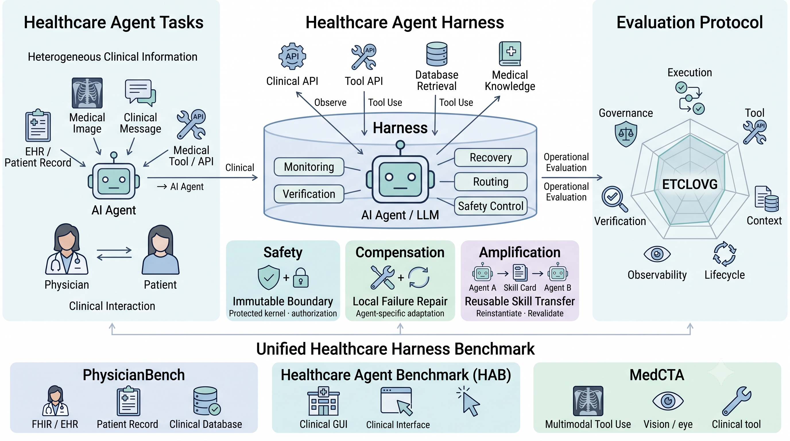

# Awesome Agent Harness for Healthcare

Medical agents must carry out multi-step tasks while keeping evidence tied to the right patient, completing intended actions, verifying their effects, and respecting clinical safety boundaries. A correct final answer alone does not show whether these requirements were met. This repository provides an evaluation harness for medical agents that records their execution and evaluates task outcomes alongside seven healthcare workflow dimensions, covering action fulfillment, resource use, evidence alignment, workflow continuity, auditability, verification, and clinical conduct.

## Benchmarks

| Benchmark | Tasks | Environment |
|---|---:|---|
| [PhysicianBench](benchmark_dataprocess/PhysicianBench/README.md) | 100 | FHIR API tools |
| [HealthAdminBench](benchmark_dataprocess/HealthAdminBench/README.md) | 135 | Web portals controlled with Playwright |
| [MedCTA](benchmark_dataprocess/MedCTA/README.md) | 107 | Image description, region description, OCR, search, and calculator tools |

Converted tasks are included in `benchmark_dataprocess/`. The [train/validation/test splits](benchmark_dataprocess/splits/README.md) contain 168/68/106 tasks. Install upstream code and runtime assets separately; see [Benchmark](benchmark/README.md) for paths and pinned revisions.

## Running

Run commands from the repository root after setting up the benchmark environment. PhysicianBench needs a running FHIR server, HealthAdminBench needs its portal and Playwright, and MedCTA needs image assets and tool services.

Configure an OpenAI-compatible endpoint and models available through your provider:

```bash
export OPENAI_API_KEY="your-api-key"
export MH_OPENAI_BASE="https://your-provider.example"
export MH_API_MODEL="gpt-5.5"
export MH_JUDGE_MODEL="gpt-5.4"
export MH_HARNESS_JUDGE_MODEL="gpt-5.4"
export LLM_JUDGE_MODEL="gpt-5.4"
```

Agent models and their tool-call protocols are listed in [runner/models.yaml](runner/models.yaml). `--agent gpt5` selects the API agent; `MH_API_MODEL` selects its model. The judge must use a different model from the agent and tool backend.

With PhysicianBench's FHIR server running on port 38080:

```bash
python3 runner/run.py --bench PhysicianBench --task PB-chronic_urticaria_allergist \
  --agent gpt5 --fhir-base http://localhost:38080/fhir --out /tmp/pb-result.json
python3 runner/run_batch.py --bench PhysicianBench --agent gpt5 --limit 10 \
  --fhir-base http://localhost:38080/fhir --out results/
python3 runner/scorers/rescore_judges.py results/gpt5 --judge-model "$MH_JUDGE_MODEL"
python3 runner/scorers/aggregate_report.py results/gpt5
```

The last two commands update judge scores and generate `report.json`. Report generation makes no model calls. See [runner/README.md](runner/README.md) for scoring details, FHIR resets, and extensions.

| Setting | Purpose |
|---|---|
| `MH_JUDGE_KEY` | Separate API key for judge calls |
| `MH_VLM_API_MODEL`, `MH_VLM_API_KEY` | Model and key for MedCTA image tools |
| `MH_SERPER_KEY` or `SERPER_API_KEY` | MedCTA search API key |
| `MH_GATEWAY_TIMEOUT`, `MH_GATEWAY_RETRIES` | API timeout and retry settings |

## Metrics

Native task outcome is reported separately: PhysicianBench and HealthAdminBench use their native checks; MedCTA uses goal accuracy (GAcc).

The seven dimensions adapt the ETCLOVG taxonomy from Li et al., *Agent Harness Engineering: A Survey*, to healthcare workflows.

| Group | Code | Dimension | Operational focus |
|---|---|---|---|
| Efficiency | CAF | Care Action Fulfillment | Completion of required care actions to their intended state. |
| | CRC | Clinical Resource Competence | Authorized, semantically valid, and productive use of clinical resources. |
| | PEA | Patient–Evidence Alignment | Acquisition of required evidence and binding to the intended clinical subject. |
| | CWC | Clinical Workflow Continuity | Ordered workflow progression, recovery from failed obligations, and appropriate termination. |
| Safety | CA | Clinical Auditability | Reconstructability of execution state, failures, recovery, and reliability. |
| | CLV | Closed-Loop Verification | Confirmation of decision-critical preconditions and post-action state changes. |
| | CCB | Clinical Conduct Boundaries | Compliance with protected patient scope, authorization, and clinical safety constraints. |

Schemas and reports use the full dimension names. Reports include coverage and scoring status alongside scores; see the [scoring details](runner/README.md#scoring).

## Outputs

[examples/](examples/) contains a task and completed run for each benchmark:

```text
examples/<benchmark>/<task_id>/
  task.json
  trajectory.jsonl
  result.json
  verifier_logs/checkpoints_full.json
```

`trajectory.jsonl` records actions, observations, delivery to the agent, and state changes. `result.json` contains checkpoint verdicts, scores, model provenance, and execution counts. Post-hoc scoring writes `result.rescored.json`; the aggregate report contains native outcome and the seven workflow dimensions. The result's `success` field is the overall checkpoint gate, rather than native task outcome.

## Extensions

| Extension | Integration point |
|---|---|
| New dataset | Add `runner/plugins/<name>.py`, register its `PLUGIN` dictionary with `substrate.register_plugin()`, provide unified tasks, and add the dataset to `spec/registry.json`. Plugin modules are discovered automatically. |
| Custom dataset functions | Supply callable semantic resolvers, evidence extractors, and task-contract resolvers in the plugin. These functions are called by the semantic and scoring pipeline. |
| Host middleware | Add a Python class to the workspace and list `<file>:<Class>` under `middleware` in `manifest.yaml`. Hooks can provide observations, request revisions, or inspect tool execution. |
| Kernel capability | Subclass `workspace_api.Capability` and register it under `kernel_middleware`. Hooks can return harness decisions before/after an action or before the final answer. |
| Custom helper functions | Define functions in a component module, or load workspace-local helpers through `workspace_api.load_relative()`, and call them from a registered hook. |

Datasets can reuse the `fhir`, `gui`, or `tool_sandbox` environment. A different tool interface needs an environment implementation; a semantic plugin alone does not add executable tools.

See the [extension guide](runner/README.md#extension-guide) for examples and hook signatures.

## Repository

```text
runner/                # execution, environments, scoring, and tests
spec/                  # JSON schemas and dataset registry
workspaces/            # agent programs, middleware, policies, and prompts
benchmark_dataprocess/ # converters, unified tasks, and splits
benchmark/             # benchmark code and assets
examples/              # recorded runs
TASK_MANIFEST.json     # dataset revisions and checksums
```

## Upstream projects

- [PhysicianBench](https://github.com/HealthRex/PhysicianBench)
- [HealthAdminBench](https://github.com/som-shahlab/health-admin-bench)
- [MedCTA](https://huggingface.co/datasets/IVUL-KAUST/MedCTA)
